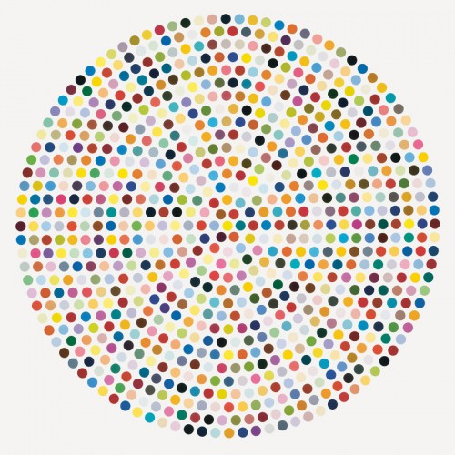

```
# import colorgram
# colors = colorgram.extract('hirst.jpg', 25)
# rgb_colors = []
# for color in colors:
#     r = color.rgb.r
#     g = color.rgb.g
#     b = color.rgb.b
#     new_color = (r, g, b)
#     rgb_colors.append(new_color)
#print(rgb_colors)

import turtle as t
import random

t.colormode(255)
jim = t.Turtle()
color_list = [(208, 158, 96), (234, 213, 101), (41, 104, 144),(149, 78, 57), (130, 168, 194), (202, 137, 162), (148, 65, 83), (24, 40, 55), (204, 90, 68), (169, 159, 55), (139, 180, 152), (193, 89, 121), (59, 117, 93), (26, 44, 36), (223, 171, 187), (63, 46, 34), (91, 154, 104), (44, 161, 182), (237, 212, 7), (226, 175, 167), (13, 96, 75)]

jim.setheading(225)
jim.penup()
jim.forward(300)
jim.setheading(0)
for _ in range(10):
    for _ in range(10):
        jim.dot(20, random.choice(color_list))
        jim.forward(50)
    jim.setheading(90)
    jim.forward(50)
    jim.setheading(180)
    jim.forward(500)
    jim.setheading(0)

screen = t.Screen()
screen.exitonclick()
```

hirst.jpg
